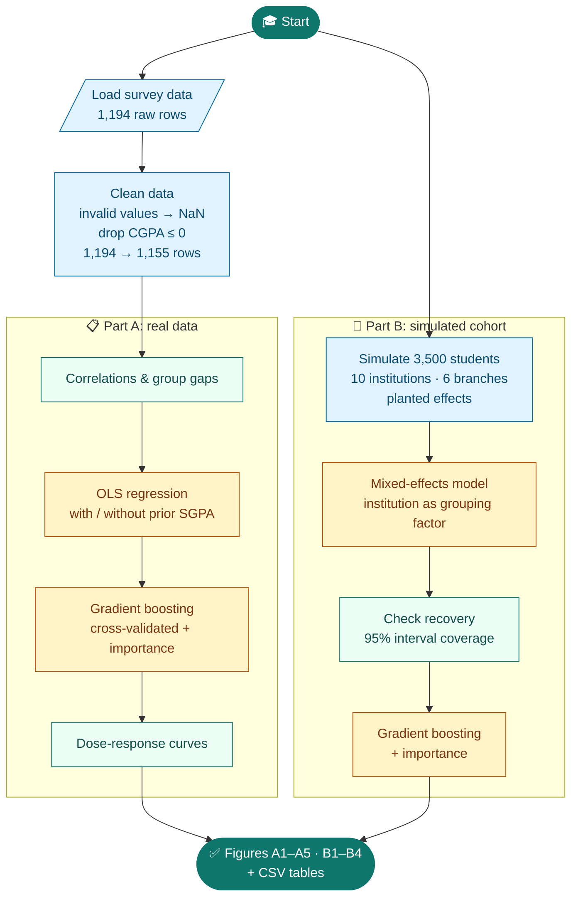

<div align="center">

# 🎓 Student Performance Analysis

**What actually drives a university student's CGPA? Real survey data, regression and machine learning, plus a simulated Indian multi-branch cohort.**


</div>

---

## 📌 Overview

A data-analysis project on **academic performance in university and the factors affecting it**.
It has two parts that are kept strictly separate:

- **Part A: real survey data.** A cleaned survey of 1,155 students, analysed with correlations,
  group comparisons, OLS regression and a gradient-boosting model.
- **Part B: simulated cohort.** A clearly labelled synthetic dataset of 3,500 students across
  10 institutions and 6 branches (CSE, DS, AI, EE, ECE, ME, CE) with *known, planted* effects.
  It tests whether the statistical methods can recover the truth, and allows branch and
  institution-tier comparisons the real survey cannot support.

This is a follow-up to the earlier BKBIET data-visualization report, which used purely simulated data.

## 📊 Results at a glance

### Part A: real data

| Metric | Value |
|---|---|
| Students after cleaning | **1,155** (from 1,194 raw rows) |
| Mean CGPA | **3.27** |
| Models | OLS regression, Gradient Boosting (cross-validated) |

| Model | R² without previous SGPA | R² with previous SGPA |
|---|---|---|
| Linear regression (OLS) | 0.09 | **0.58** |
| Gradient boosting | 0.05 | **0.69** |

> ⚠️ **Honest note:** without previous SGPA the survey factors explain very little of CGPA
> (R² of 0.05 to 0.09). Past performance is by far the strongest signal. See
> [Limitations](#-limitations-and-next-steps).

### Part B: simulated cohort

| Metric | Value |
|---|---|
| Students | **3,500** |
| Planted effects recovered inside the 95% interval | **94%** (17 of 18) |
| Prediction R² (gradient boosting) | 0.60 |
| CGPA variance between institutions (ICC) | 0.05 |

> ⚠️ Part B shows what the *method* can detect in synthetic data. It is not evidence about real students.

## 🖼️ Visualisations

All graphs are generated by the notebook and saved in [`figures/`](figures/).

**Part A: real data**

| | |
|---|---|
| **A1. Correlations**<br>Pairwise relationships with CGPA<br> | **A2. Group gaps**<br>CGPA differences between groups<br> |
| **A3. Regression**<br>OLS coefficients with intervals<br> | **A4. Feature importance**<br>Gradient-boosting importance<br> |

**A5. Dose-response**


**Part B: simulated cohort**

| | |
|---|---|
| **B1. CGPA by branch**<br> | **B2. Recovered vs true effects**<br> |
| **B3. Study hours by branch**<br> | **B4. Feature importance**<br> |

## 🔍 Key findings

- **Previous SGPA dominates.** Adding it lifts explained variance from under 10% to 58 to 69%. Its
  regression coefficient is about 0.40.
- **Without previous SGPA**, significant predictors are **attendance (+)**, **English score (+)**,
  **social hours (−)** and **living arrangement**.
- **With previous SGPA controlled**, English score, family income (log), semester, relationship status,
  age (−) and consultancy (−) also come out significant.
- **Self-reported daily study hours showed no significant link** with CGPA in either model
  (p ≈ 0.6 and 0.7).
- **In the simulated cohort**, Class 12 %, attendance, stress, screen time and sleep were recovered
  almost exactly. Study hours was the one effect outside its interval (true 0.20, estimated 0.246).
  Branches were estimated relative to EE (DS and CSE above, ME below).

## 🛠️ How it works



1. **Load and clean**: survey rows are validated; implausible values (attendance invalid, social hours over
   16 h/day, semester over 12) become missing, and students with CGPA ≤ 0 (no graded work yet) are removed.
2. **Explore**: correlations and group comparisons against CGPA.
3. **Regress**: two OLS specifications, with and without previous SGPA, reporting 95% intervals and p-values.
4. **Predict**: cross-validated gradient boosting and feature importance.
5. **Simulate**: build a synthetic cohort with planted effects.
6. **Recover**: fit a mixed-effects model and test whether the 95% intervals contain the true effects.

### 🧹 Cleaning log

| Step | Rows affected |
|---|---|
| Raw rows | 1,194 |
| Attendance missing or invalid → NaN | 1 |
| Social hours > 16 h/day → NaN | 1 |
| Semester > 12 → NaN | 36 |
| CGPA ≤ 0 removed | 39 |
| **Clean rows** | **1,155** |

## 🚀 Getting started

**1. Clone the repository**
```bash
git clone https://github.com/BERSERKER1706/student-performance-analysis.git
cd student-performance-analysis
```

**2. Install the dependencies**
```bash
pip install pandas numpy scipy statsmodels scikit-learn matplotlib jupyter
```

**3. Open the notebook**
```bash
jupyter notebook Students_perfromnace.ipynb
```
Run all cells in order. The first cells find the project root (the folder containing `src/`), so it
works from any launch directory. Figures and tables are written to `figures/` and `tables/`.

## 📁 Project structure

```
student_performance_project/
├── src/
│   ├── config.py              # paths (FIG, TAB output folders)
│   ├── cleaning.py            # load_and_clean(): cleaning pipeline + log
│   ├── analysis_real.py       # Part A: correlations, OLS, GBM, dose-response
│   ├── simulate.py            # Part B: synthetic cohort generator
│   └── analysis_india.py      # Part B: mixed model, recovery check, GBM
├── Students_perfromnace.ipynb # runs everything and displays the results
├── figures/                   # A1–A5 and B1–B4 graphs
├── tables/                    # cleaning log, OLS coefficients, recovered vs true
└── README.md
```

## 🧰 Tech stack

- **Python**
- **pandas** and **NumPy** for data handling
- **SciPy** and **statsmodels** for statistics, OLS and mixed-effects models
- **scikit-learn** for gradient boosting and cross-validation
- **matplotlib** for visualisation
- **Jupyter Notebook**

## ⚠️ Limitations and next steps

- Survey data is self-reported and cross-sectional: it shows association, not causation.
- Study hours are self-reported and probably noisy, which may hide a real effect.
- Without previous SGPA the model explains under 10% of CGPA, so key drivers such as prior ability,
  teaching quality and motivation are not captured by the survey.
- Part B is synthetic by construction. Its effects are known because they were planted.
- Next steps: collect multi-branch real data, add longitudinal (semester-by-semester) tracking, and
  build a small web demo for predicting CGPA risk.

## 👤 Author

**Sir Skull**: B.Tech Computer Science student, B.K. Birla Institute of Engineering and Technology, Pilani.

GitHub: [@BERSERKER1706](https://github.com/BERSERKER1706)

---

<div align="center">

If you found this useful, give it a ⭐

</div>
